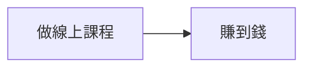
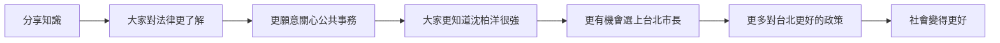

前陣子聽了台灣通勤第一品牌的節目，《EP555 詳解 ft. [沈伯洋](https://zh.wikipedia.org/zh-tw/%E6%B2%88%E4%BC%AF%E6%B4%8B)》。在節目中，主持人跟來賓聊到，為什麼沈柏洋要把自己的刑法[課程](https://youtu.be/tKnQp1mC2SU?si=XoFevREZ9pkmc4i-)錄下來，**免費**的放在網路上讓大家看。

沈柏洋其中的一段回答是這樣：
> 你今天既然有能力吸收那麼多知識，然後你又可以統整，就應該讓大家都可以這個樣子。因為這個社會才會變好，阿你一個人變好沒有任何意義。

<iframe width="560" height="315" src="https://www.youtube.com/embed/PWGbn-9DS20?si=zJvAco427gp95hQ_&amp;start=315" title="YouTube video player" frameborder="0" allow="accelerometer; autoplay; clipboard-write; encrypted-media; gyroscope; picture-in-picture; web-share" referrerpolicy="strict-origin-when-cross-origin" allowfullscreen></iframe>

### 利益回收的時間

膝反射的想法可能會是，阿他怎麼那麼笨，這個做成線上課程不知道能賺多少錢。可是，如果是做成線上課程，這件事情就只停在**賺到線上課程的學費**而已，在很短的時間拿到利益而已（但也沒有不對啦。

但分享統整好的課程造成的影響是這樣： 

### 從小地方開始分享知識

如果你自認為是一個知識份子，請不要吝嗇的開始分享知識吧！然後我覺得分享知識的方式其實有很多，不需要像沈柏洋那樣，花很多時間跟精力去做課程，檢影片。這樣子其實也給自己太大的壓力了。

例如：
- 在 blog 寫文章
- 跟朋友聊天的時候當作話題
- 同事有困難的時候去教他
- 在公司開知識分享會

從小地方開始做起，其實就會從自己一時還看不到的地方開始發揮影響力了。